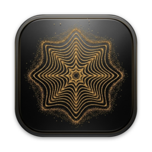
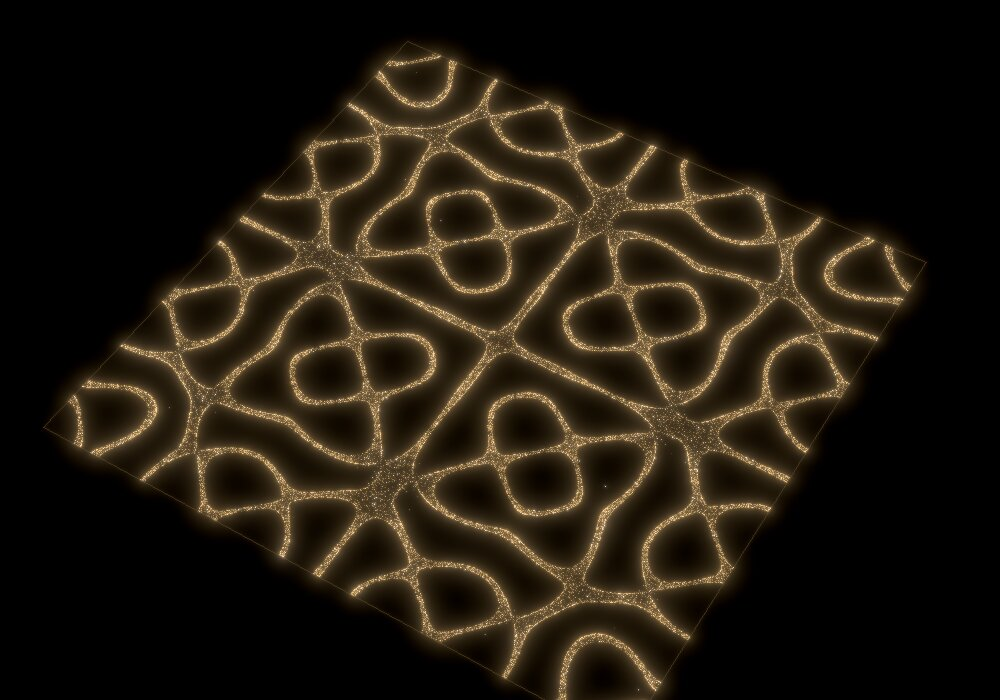
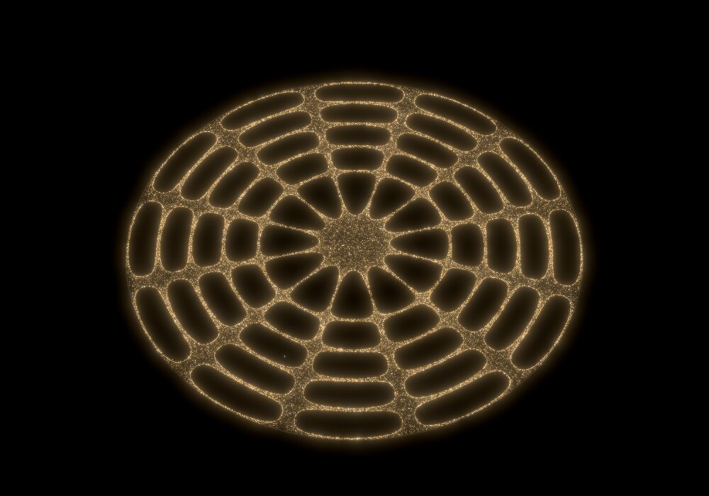
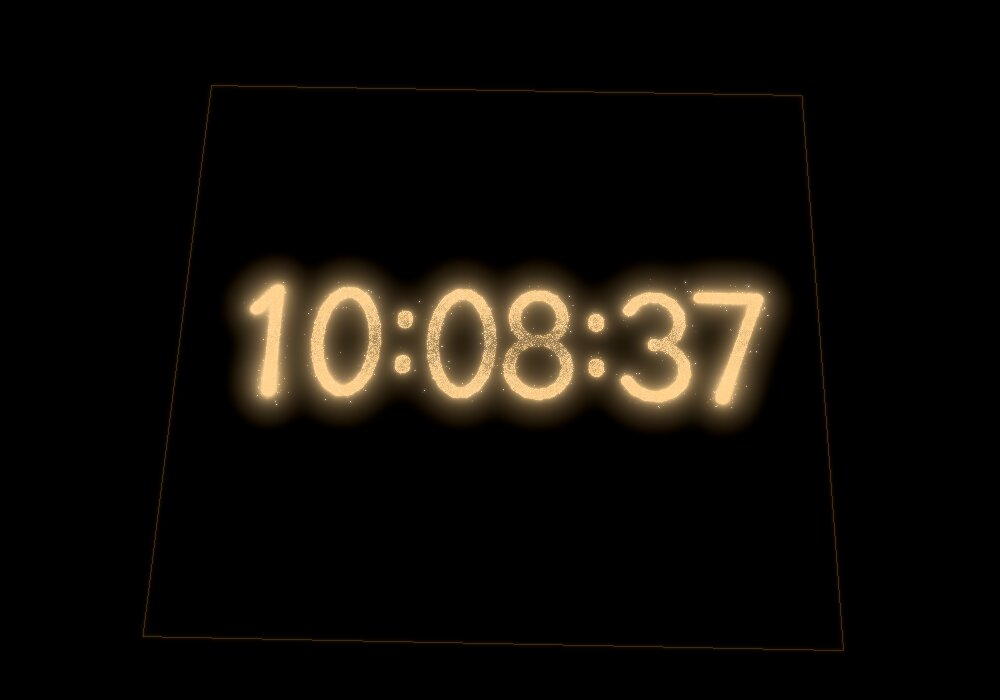
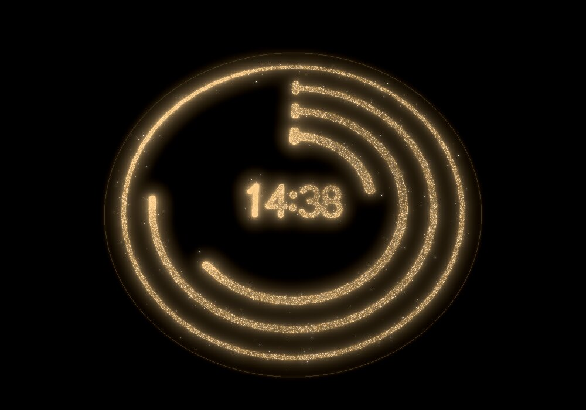
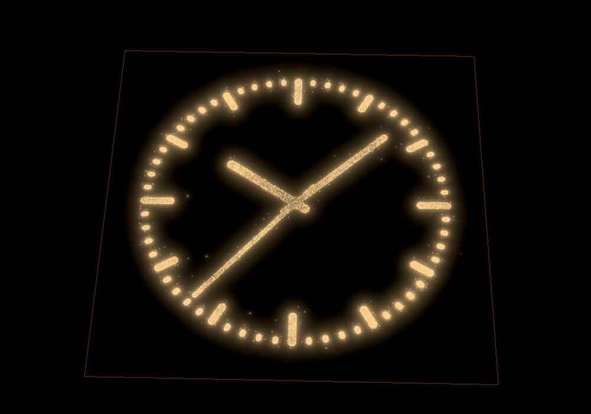
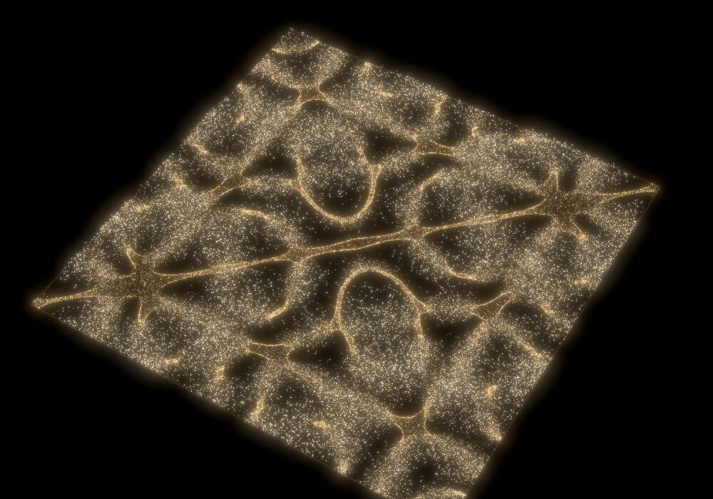
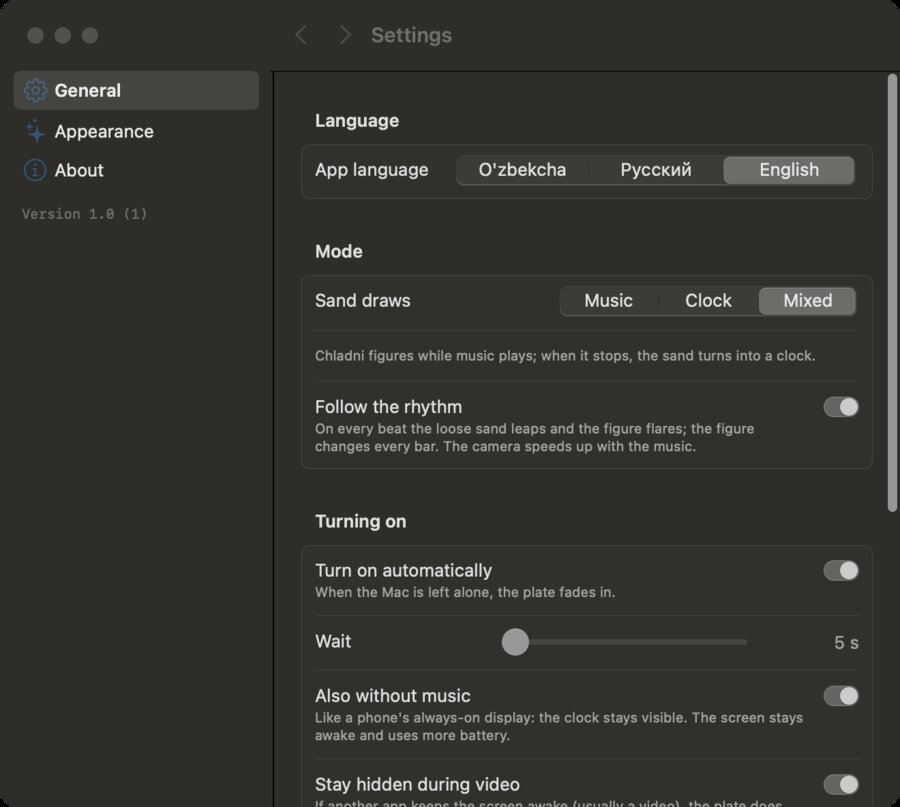
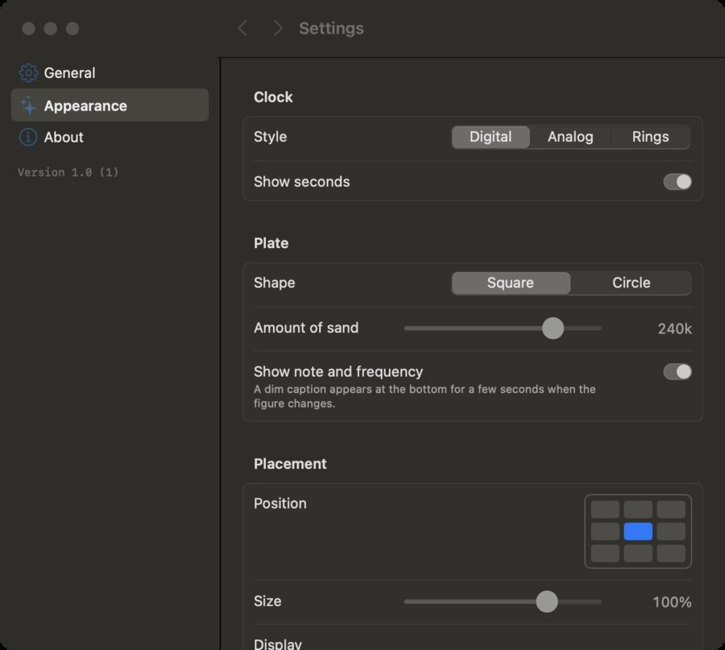

<p align="center"></p>

<h1 align="center">Cymatica</h1>

<p align="center">Golden sand that dances to your music: a Chladni-figure always-on display for macOS.</p>

<table>
  <tr>
    <td></td>
    <td></td>
  </tr>
  <tr>
    <td></td>
    <td></td>
  </tr>
</table>

Leave your Mac alone while music plays and the screen fades to black. A metal plate
appears, covered in golden sand. The plate vibrates at the note the song is built on,
and the sand runs to the lines where the plate stands still. Those lines are
[Chladni figures](https://en.wikipedia.org/wiki/Ernst_Chladni#Chladni_figures). When
the harmony changes, the old lines start to shake, the sand jumps, and it settles into
the new figure. Touch the trackpad and it is gone.

It is a physics simulation, not a decoration. Higher notes ring higher modes with more
nodal lines. Quiet passages draw simple figures and choruses draw intricate ones.

## Modes

| Mode | What the sand draws |
|---|---|
| **Music** | Chladni figures picked by the song's dominant pitch and section loudness |
| **Clock** | The current time, as digits, an analog face, or rings. When a second ticks, only that digit's (or hand's) sand jumps |
| **Mixed** (default) | Chladni figures while music plays, the clock a few seconds after it stops |

**Follow the rhythm** is an optional switch. With it on, the loose sand between the
lines leaps on every beat and the figure flares, while the sand on the lines stays put
so the figure stays readable. The figure changes once per bar, and the camera speeds
up in loud passages. Without it, the plate follows harmony only. The colour always
follows the key: warm gold for major, pale champagne for minor.

<p align="center">
</p>

## Requirements

- macOS 15 or later (system audio capture uses Core Audio process taps)
- Apple silicon recommended; an XDR display makes the sparkles brighter than white
- Xcode with the Swift 6 toolchain (to build)

## Build and run

```bash
git clone https://github.com/Xazratbek/cymatica.git
cd cymatica
./build_app.sh            # builds build/Cymatica.app (release, ad-hoc signed)
open build/Cymatica.app   # a ✦ icon appears in the menu bar
```

On first launch macOS asks for **System Audio Recording** permission; allow it. You
can change it later in System Settings › Privacy & Security › Screen & System Audio
Recording. Audio is analysed in memory only; nothing is recorded or sent anywhere.
The build is ad-hoc signed, so after rebuilding macOS may ask again.

## Using it

The interface speaks **English, Russian and Uzbek**. Pick one at the top of
Settings › General; it switches instantly. The menu bar icon offers **Show now** (⌘S),
the three modes, **Follow the rhythm**, **Turn on automatically**, and **Settings…** (⌘,).
The settings window has:

- **General:** language, mode, rhythm, idle time before the plate appears, *also
  without music* (a phone-style always-on clock), *stay hidden during video*, *keys do
  not close it* (then only the trackpad or mouse does), launch at login
- **Appearance:** clock style and seconds, plate shape (square or circle), amount of
  sand, position on screen (3 × 3 grid) and size, which display, 60/120 FPS

<p align="center">
</p>

## How it works

- **Audio.** A Core Audio process tap captures everything the Mac plays (Spotify, a
  browser, Apple Music) with no microphone and no virtual driver. The real-time callback
  only copies samples into a lock-free ring buffer.
- **Analysis.** Chroma comes from the peaks of a 16384-point FFT. The dominant pitch
  class switches with hysteresis and a minimum hold of about 2 s, because sand needs
  that long to settle. Section loudness relative to the last minute sets the figure's
  complexity, spectral flux finds onsets and beats, and Krumhansl key profiles tell
  major from minor.
- **Physics.** The square plate uses the classic Chladni/Ritz modes
  `cos(nπx)·cos(mπy) ± cos(mπx)·cos(nπy)` with frequency ∝ m² + n². The circular plate
  uses `J_n(k·r)·cos(nθ)`. A grain only hops when the plate under it accelerates harder
  than gravity, so it comes to rest where the plate barely moves: on the nodal lines.
  In clock mode the field is the distance to the digit or hand strokes instead. It is
  baked into a 1024² texture once per second, when the time changes, so each grain pays
  one texture read per frame rather than a loop over hundreds of strokes.
- **Rendering.** The grains live only on the GPU: a Metal compute pass moves them and
  additive point sprites draw them into a float target. A dual-filter bloom adds the
  glow, and the composite writes EDR values on XDR displays. Empty space stays at
  exactly 0, so mini-LED zones there remain off.
- **Cost.** With 300,000 grains at 3024 × 1964 on an M2 Pro, a frame takes about 1 ms of
  GPU time in every mode. Audio analysis runs at most 60 times a second even at 120 FPS.
- **Power.** Rendering stops while the plate is hidden, which costs about 0.1% CPU. The
  display is kept awake only while the plate is showing music or the always-on clock.

## Developer commands

```bash
B=.build/release/Cymatica
$B --snapshot out.png --mode 2,0 --frames 360                 # tier,pitch class → PNG
$B --snapshot out.png --circle --mode 1,4
$B --snapshot out.png --mode 1,9 --then 1,4 --after 25        # the jump between figures
$B --snapshot out.png --clock digital --time 10:08:37 --after 40
$B --snapshot out.png --clock rings --time 14:38:45 --place 4 --plate-size 0.6
$B --analyze song.wav                                         # pitch, tier, beats per second
open build/Cymatica.app --args --demo                         # no audio needed
```

## Project layout

```
Sources/Cymatica/
  SystemAudioTap.swift     Core Audio process tap → ring buffer
  AudioRing.swift          lock-free single-producer ring
  MusicAnalyzer.swift      FFT, chroma, pitch, sections, beats, key
  PlateField.swift         mode tables and crossfades (square and circle plates)
  ClockFace.swift          stroke font and clock faces
  Shaders.swift            Metal: simulation, sand, bloom, composite
  Renderer.swift           GPU passes, camera, placement
  Visualizer.swift         per-frame glue between music, modes and renderer
  AODController.swift      always-on-display window, idle detection, sleep assertion
  AppDelegate.swift        menu bar app
  Settings*.swift          settings model and the SwiftUI settings window
```

More ideas for future modes are collected in [`idea.txt`](idea.txt) (in Uzbek).

---

## O'zbekcha

**Cymatica** — macOS uchun musiqa "always on display"i. Qora tebranuvchi plastinkada
oltin qum musiqaning asosiy notasiga mos Xladni naqshlarini chizadi. Akkord
almashsa, qum sakrab yangi naqsh bo'lib qayta yig'iladi. **Soat** rejimida qum
vaqtni chizadi (raqamli, doira yoki halqalar), **Aralash** rejimda musiqa to'xtasa
soatga o'tadi. Xohlasangiz, "Musiqa ritmiga moslashsin" tugmasi qumni har zarbda
sakratadi.

Ishga tushirish: `./build_app.sh`, keyin `open build/Cymatica.app`. Birinchi safar
"System Audio Recording" ruxsatiga **Allow** bosing. Sozlamalar menyu satridagi ✦
belgisidan ochiladi (⌘,). Ilova tili o'zbek, rus yoki ingliz — Sozlamalar › Umumiy
bo'limining eng tepasida tanlanadi.
